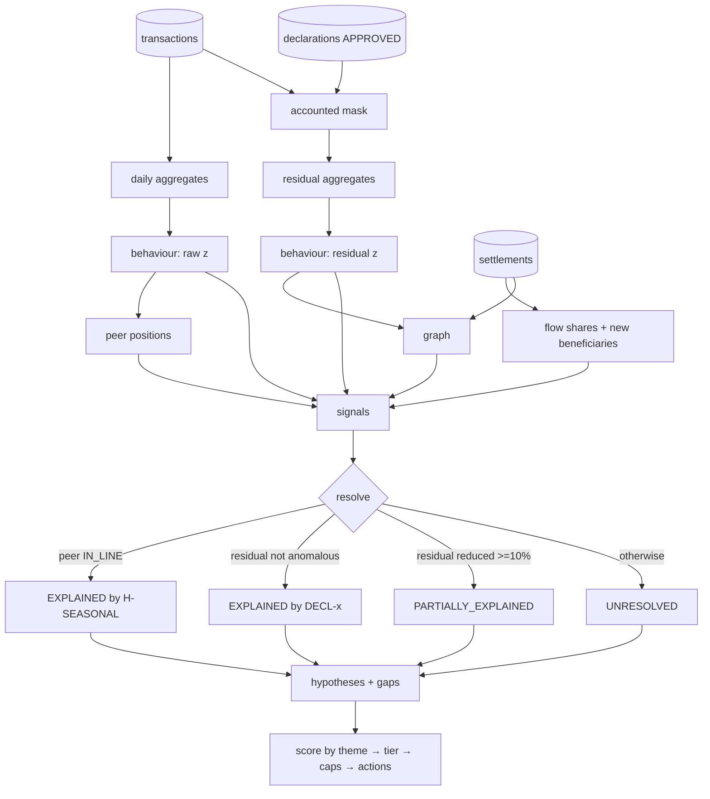
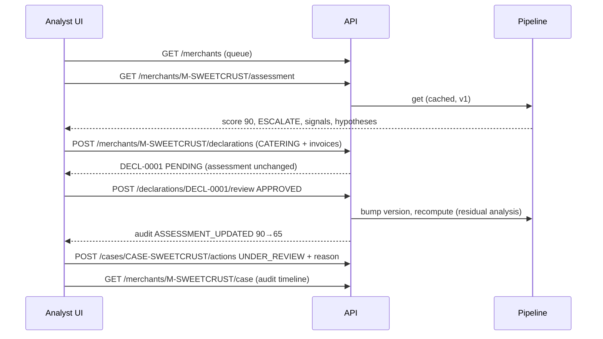

# VERITY architecture

Scope and requirement IDs: [../PROJECT_SOURCE_OF_TRUTH.md](../PROJECT_SOURCE_OF_TRUTH.md). Interfaces: [../contracts/API.md](../contracts/API.md).

## Components

| Component | Path | Responsibility | Inputs → outputs |
|---|---|---|---|
| Seed generator | `backend/verity/seed.py` | Deterministic synthetic merchants, transactions, settlements, invoices (FR-001) | seed → SQLite rows |
| Persistence | `backend/verity/db.py` | Schema, append-only audit trigger, data version | – |
| Features | `engines/features.py` | Daily sums → feature ratios; expected profile; residual mask from approved declarations | transactions, declarations → daily aggregates |
| Identity engine | `engines/identity.py` | Declared vs observed checks (context, not scored) (FR-002) | aggregates → checks |
| Behaviour engine | `engines/behaviour.py` | Own-baseline drift, raw and residual (FR-003) | aggregates → feature rows |
| Peer engine | `engines/peer.py` | Drift vs comparable cohort, min cohort 5 (FR-004) | all behaviour rows → positions |
| Flow engine | `engines/flow.py` | Settlement shares, new beneficiaries, source→merchant→beneficiary flow (FR-005) | settlements → shares, signals |
| Network engine | `engines/network.py` | Merchant–beneficiary graph, leads vs benign links (FR-006) | settlements + behaviour → graph, leads |
| Context engine | `engines/context.py` | Signal resolution and counterfactual hypotheses (FR-007) | all engines → resolutions, hypotheses |
| Response engine | `engines/response.py` | Theme-based score, confidence, completeness, tier caps, actions (FR-009, FR-011) | signals → risk + recommendation |
| Pipeline | `engines/pipeline.py` | Runs all engines for all merchants; cache per data version | DB → assessments |
| Inline scorer | `backend/verity/scoring.py` | Per-transaction indicators behind a `Scorer` protocol (FR-012) | baseline → indicators + latency |
| API | `backend/verity/api.py` | REST endpoints, declaration review loop, cases, audit, static UI | HTTP ↔ pipeline/DB |
| UI | `frontend/` | Investigator console (FR-013) | API → screens |

## Assessment data flow

## Scoring rule (explainable by construction)
`score = Σ_theme max_signal(points[severity] × factor[resolution])`, capped at 100.
Points: high 25, medium 15, low 8, network lead 10. Factors: unresolved 1, partial 0.5, explained 0.
Severity of a behaviour signal comes from |z|: ≥10 high, ≥5 medium, else low. Themes stop correlated signals (e.g. repeated amounts and high-value share) from double-counting.
Tiers: ≥80 escalate, ≥60 analyst review, ≥40 clarification, ≥20 enhanced, else passive. Confidence < 0.5 caps at clarification; onboarding merchants get enhanced monitoring as a lifecycle default.

## Critical journey

## Deployment
**Local (reference):** single process — `uvicorn verity.api:app` serves `/api/*` and the built UI from `frontend/dist`. SQLite file at `VERITY_DB` (default `backend/verity.db`), seeded on first start and on `POST /api/demo/reset`. Run one worker only: the fitted inline scorer is process-local (R-09).

**Hosted (Vercel, DEC-015):** https://bet-catcher.vercel.app. Vercel builds `frontend/` and serves `frontend/dist` statically; `/api/*` is rewritten to the Python function `api/index.py`, which imports the same `verity.api:app`, sets `VERITY_DB=/tmp/verity.db` and seeds at import (serverless may skip ASGI lifespan). State is per instance and lost on cold start (R-10). Deploys: `vercel deploy --prod`, or `.github/workflows/deploy.yml` after green CI on `main` when the `VERCEL_TOKEN` secret is set.

## Demo → production path (Proposed, not built)
| Demo | Production |
|---|---|
| SQLite, synthetic seed | Acquirer ledger feeds (Db2 for z/OS / CDC into LinuxONE) |
| NumPy robust baseline in-process | Same features; model exported to ONNX, compiled with IBM zDLC for Telum; called from the authorisation path |
| Single-user API, no auth | SSO, role-based access (analyst vs merchant portal), field-level encryption |
| In-memory cache per data version | Incremental feature store, streaming windows |
| Rules-based hypotheses | Same rules + analyst feedback loop for threshold calibration; any LLM summary must cite these records |
| Local network graph | Cross-provider signals inside IBM Secure Execution enclaves with attestation (Concept 9) |
