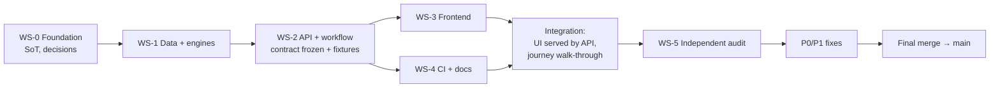

# Dependency map

See [WORKSTREAMS.md](WORKSTREAMS.md) for ownership.

**Critical path:** WS-0 → WS-1 → WS-2 → WS-3 → integration → WS-5 → fixes → main.
WS-3 and WS-4 run in parallel once the contract is frozen (separate worktrees, disjoint files).

| Edge | What is handed over | Mock/fallback if late |
|---|---|---|
| WS-1 → WS-2 | `pipeline.get()` | – (same owner) |
| WS-2 → WS-3 | API.md + 16 recorded fixtures | UI can be built against fixtures only |
| WS-3 → integration | `frontend/dist` | API still demoable via `/docs` (Swagger) and `test_e2e.py` |
| integration → WS-5 | integrated branch | – |
